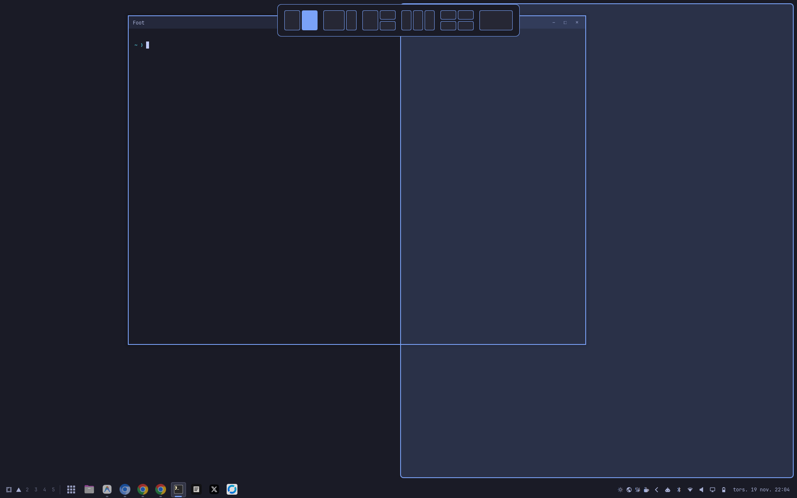
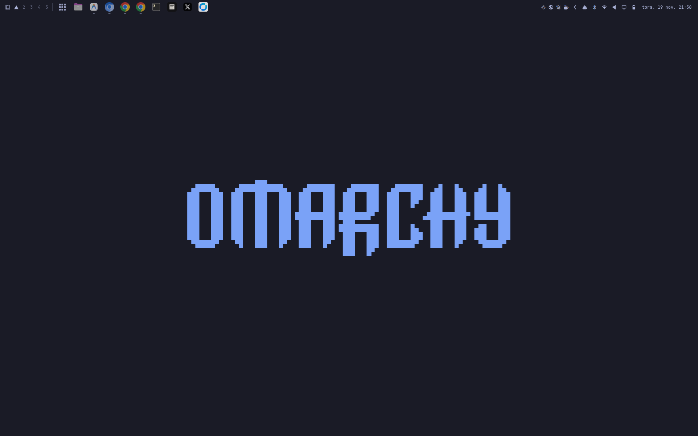
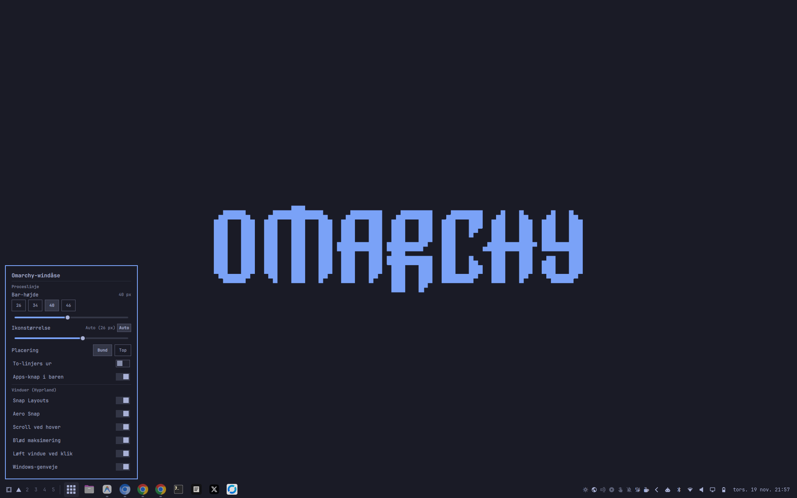

<div align="center">

# Omarchy-windåse

**Familiar Windows 11 desktop ergonomics for Omarchy 4.5 - zero bloat, zero core-file edits.**

*("Windåse" is Danish wordplay for Windows - literally "wind-can".)*

[](https://omarchy.org)
[](#architecture)
[](#all-50-omarchy-locales-with-rtl)
[](#why-omarchy-windåse)
[](LICENSE)

[Features](#features) · [Quick Start](#quick-start) · [Shortcuts](#shortcuts) · [Configuration](#configuration) · [Architecture](#architecture) · [Uninstall](#uninstall)

<br>



*Windows 11 Snap Layouts overlay with live drop-zone preview and the 40 px in-bar taskbar on Omarchy 4.5.*

</div>

---

## Why Omarchy-windåse?

If you like Hyprland and Omarchy's speed, aesthetic, and keyboard workflow - yet sometimes just want a floating Windows 11-style taskbar, drag-to-snap zone cards, and clean overlapping windows - **Omarchy-windåse** adds all of it without fighting the distro:

- **One bar, full vertical space** - Pinned and running apps live directly inside the Omarchy bar instead of a separate dock stealing screen height.
- **Zero fork, zero `/usr/share/omarchy/` edits** - Installed purely in `~/.config/omarchy/` and `~/.config/hypr/`, surviving every Omarchy package update and theme switch cleanly.
- **Zero bloat & 0% idle CPU** - Native Quickshell QML + event-driven Hyprland Lua. No polling loops when windows are still, no Electron, no extra background daemons.

---

## Features

### In-Bar Taskbar & 3×3 Apps Launcher
- **Pinned + active windows right inside the bar** (`BarWidget.qml`) alongside Omarchy's own 3×3 **Apps** launcher button (`Super + Alt + Space`).
- **Smart click behavior** - Left-click focuses or toggles minimize on single-window apps, middle-click spawns a new window, and multi-window apps open an upward picker (`WindowPickerCard.qml`) with workspace badges (`W1`, etc.) and per-window close buttons.
- **Scales cleanly with tall bars** - Pair with a `40 px` bar height (`--bar-height 40` or in the Settings UI) to grow app icons without blowing up system tray icons, and switch Omarchy's clock to a two-line Windows 11 layout (`HH:mm` / `dd-MM-yyyy`).



*40 px single-bar taskbar positioned at the top with split Chrome windows and the 3×3 Apps launcher button.*

### Visual All-Apps Grid (`AppGrid.qml`)
- Triggered from the bar's 3×3 Apps button or `Super + Alt + Space`.
- Instant **type-to-filter** search across app names and desktop keywords.
- Full keyboard navigation (`Arrow keys`, `Enter`, `Delete`, `Esc`) plus right-click actions (*Open*, *Pin/Unpin*, *Uninstall*).

### Per-Window Browser Splitting & Live Chromium Profiles
- **1-click *Split windows in taskbar* (`AppMenuCard.qml`)** - Right-click any taskbar icon to uncombine its windows into separate taskbar buttons with window-title tooltips (`uncombine`), persisted directly in `shell.json`.
- **Live browser profiles** - Right-click **Google Chrome**, **Chromium**, or **Brave** to launch any profile directly from its `Local State` metadata with profile avatars and account emails.

### Windows 11 Snap Layouts & Aero Snap
Drag any floating window to the top edge of any monitor - or press **`Super + Z`** - to trigger the native themed **Snap Layouts** overlay (`Service.qml` + `snap_layouts.lua`) with live drop-zone previews and pixel-accurate `hyprbars` inset compensation:

```text
┌────┬────┐  ┌──────┬──┐  ┌────┬────┐  ┌──┬──┬──┐  ┌────┬────┐  ┌─────────┐
│    │    │  │      │  │  │    │    │  │  │  │  │  │    │    │  │         │
│    │    │  │      │  │  │    ├────┤  │  │  │  │  ├────┼────┤  │         │
│    │    │  │      │  │  │    │    │  │  │  │  │  │    │    │  │         │
└────┴────┘  └──────┴──┘  └────┴────┘  └──┴──┴──┘  └────┴────┘  └─────────┘
  50 / 50      65 / 35     50 | 25/25    33/33/33      2 × 2        100%
```

- **Multi-monitor aware** - Automatically mirrors onto whichever monitor your cursor enters, respecting each monitor's reserved bar margins and gaps.
- **Aero Snap** - Drag floating windows to screen corners/edges or step cleanly between halves, quarters, maximize, and minimize via `Super + Arrow` keys (`snap.lua`).

### Native Graphical Settings UI
Right-click the **3×3 Apps button**, right-click any taskbar icon → *Windåse settings*, or run `omarchy-shell riisager.windaase settings` to open `SettingsCard.qml`:

- **Taskbar:** Bar height presets (`26` / `34` / `40` / `46 px`) + `26–56 px` slider, icon size (`Auto` or manual px), bar position (`Bottom` / `Top`), two-line clock toggle, Apps button toggle.
- **Windows (Hyprland):** Live toggles for *Snap Layouts*, *Aero Snap*, *Hover-scroll*, *Soft-maximize*, *Auto-raise*, and *Windows shortcuts*, persisted atomically to `~/.config/omarchy/windaase.json`.



*Native Settings popup (`SettingsCard.qml`) live-localized via Omarchy's language selector.*

### Hyprland Floating Ergonomics
- **Soft-maximize (no `hasfullscreen` click-trap)** - Replaces Hyprland's native `fullscreen = 1` on floating workspaces with an edge-to-edge floating geometry restore/maximize (leaving true `fullscreen = 2` untouched), so clicking overlapping windows on top never locks input behind a maximized layer.
- **Auto-raise on focus** - Automatically brings the focused floating window to the top of the z-order.
- **Hover-scroll (`follow_mouse = 2`)** - Enforces scroll-under-cursor on floating workspaces without stealing keyboard focus until you click (`focus.lua`).
- **In-process Show Desktop (`Super + D`)** - Pure Lua workspace minimize/restore toggle (`show_desktop.lua`) with zero subprocess spawning.

### All 50 Omarchy Locales with RTL
- Ships translation catalogs for **all 50 locales** in `/usr/share/omarchy/default/i18n/locales.json` (`i18n/*.json`), reusing Omarchy's official translations for shared strings and switching live with *Omarchy Setup → Language*.
- Automatically mirrors card and popup layouts for RTL languages (**Arabic** `ar`, **Persian** `fa`, **Hebrew** `he`, **Urdu** `ur`).

---

## Quick Start

### Option A - Full Windows 11 Desktop Experience (Recommended)

Installs the Omarchy shell plugin + `hypr.windaase` Lua module, moves the bar to the bottom, disables `omarchy.dock`, and sets workspaces to `floating` by default:

```bash
git clone https://github.com/riisager/omarchy-windaase.git
cd omarchy-windaase
./install.sh --full --bar-height 40
```

> Want standard bar height (`26 px`) instead? Drop `--bar-height 40`.  
> Prefer to keep your existing bar position, dock, and tiling defaults? Run `./install.sh` without `--full`.

### Option B - Shell Plugin Only (via Omarchy CLI)

```bash
omarchy plugin add https://github.com/riisager/omarchy-windaase.git --enable
```

Or from a local clone:

```bash
./install.sh --shell-only
```

*(Shell-only installs the taskbar widget, All-Apps grid, settings popup, and Snap Layouts overlay host; `hypr.windaase` handles drag-snap, Aero Snap, soft-maximize, auto-raise, hover-scroll, and `Super + D`/`Super + Z`.)*

### Installer Flags

| Flag | Effect |
| --- | --- |
| `(default)` | Installs `riisager.windaase` shell plugin + `hypr.windaase` Lua module and loads it in `~/.config/hypr/hyprland.lua`. |
| `--full` | Default install + sets workspace layout to `floating`, disables `omarchy.dock`, moves bar to `bottom`. |
| `--shell-only` | Installs only the Quickshell plugin (skips Hyprland Lua files and bindings). |
| `--bar-height <px>` | Sets `[bar] size-horizontal` (`24–64 px`) atomically in `~/.config/omarchy/shell.toml`. |

`install.sh` stages and runs `omarchy plugin validate` before swapping directories, and automatically creates timestamped `.bak-*` backups before modifying `hyprland.lua` or `shell.toml`.

---

## Shortcuts

### Keyboard Shortcuts (`shortcuts = true`)

| Shortcut | Floating Workspace / Window | Tiled Fallback / Action |
| --- | --- | --- |
| `Super + Alt + Space` | Toggle visual **All-Apps Grid** | Same |
| `Super + Z` | Toggle click **Snap Layouts** bar | Same |
| `Super + Left` / `Right` | Snap left/right half (or step from top/bottom/opposite snap) | Focus left / right |
| `Super + Up` | Soft-maximize (or promote left/right half → top corner) | Focus up |
| `Super + Down` | Un-maximize / un-snap step by step / minimize window | Focus down |
| `Super + D` | Toggle **Show Desktop** (minimize / restore workspace) | Same |
| `Super + E` | Open File Manager (`nautilus`) | Same |
| `Alt + F4` | Close active window | Same |

### Taskbar Mouse Actions

| Input | Target | Action |
| --- | --- | --- |
| **Left-click** | Single-window / pinned app | Focus, minimize if already focused, or launch |
| **Left-click** | Multi-window grouped app | Open upward window picker with workspace badges & close buttons |
| **Middle-click** | Any taskbar app icon | Open a new window (`gtk-launch` / entry command) |
| **Right-click** | Any taskbar app icon | Open context menu (Chrome/Chromium/Brave profiles, Pin/Unpin, *Split windows in taskbar*, *Windåse settings*, Close all) |
| **Right-click** | 3×3 **Apps** button | Open **Omarchy-windåse** Settings popup |

### Shell IPC

```bash
omarchy-shell riisager.windaase apps      # Toggle visual All-Apps Grid
omarchy-shell riisager.windaase settings  # Toggle Windåse Settings popup
```

---

## Configuration

### Graphical Settings (No Terminal Needed)
Most users never need to touch a config file:
- Right-click the **3×3 Apps button** (or any taskbar icon → *Windåse settings*) to tweak bar height, icon size, position, clock style, and live Hyprland toggles.
- Right-click any taskbar icon → ***Split windows in taskbar*** to toggle per-window splitting (`uncombine`) in one click.

### Taskbar Options in `~/.config/omarchy/shell.json`

Configure placement in `bar.layout`, override icon size (`0` = automatic scaling with bar height), toggle the 3×3 Apps button (`showAppsButton`), or pre-configure uncombined desktop IDs:

```json
{
  "bar": {
    "position": "bottom",
    "layout": {
      "left": [
        { "id": "omarchy.menu" },
        { "id": "omarchy.workspaces" },
        {
          "id": "riisager.windaase",
          "showAppsButton": true,
          "iconSize": 0,
          "uncombine": ["google-chrome"]
        }
      ],
      "right": [
        { "id": "omarchy.clock", "format": "HH:mm\ndd-MM-yyyy" }
      ]
    }
  }
}
```

### Tall Bar & Two-Line Windows 11 Clock
Omarchy 4.5 reads user overrides from `~/.config/omarchy/shell.toml`, keeping them intact across theme changes and updates:

```toml
[bar]
size-horizontal = 40
```

Or run `./windaase-config.py bar-height 40` / `./windaase-config.py two-line-clock on` (or toggle directly in **Settings**).

### Hyprland Options (`~/.config/hypr/hyprland.lua` & `~/.config/omarchy/windaase.json`)

The graphical Settings popup writes Hyprland toggles atomically to `~/.config/omarchy/windaase.json` and reloads Hyprland. Any explicit option passed to `setup({...})` in `~/.config/hypr/hyprland.lua` takes precedence over `windaase.json` and built-in defaults:

```lua
require("hypr.windaase").setup({
  aero_snap = true,     -- Super + Arrow keys & edge-drag snap
  snap_layouts = true,  -- Top-edge drag Snap Layouts & Super + Z
  soft_maximize = true, -- Edge-to-edge maximize without fullscreen=1 click lock
  auto_raise = true,    -- Raise floating window to top on focus
  hover_scroll = true,  -- Enforce input.follow_mouse = 2
  shortcuts = true,     -- Alt+F4, Super+D, Super+E, Super+Alt+Space
  gap_out = 8,          -- Outer gap around snapped work area (px)
  gap_in = 8,           -- Inner gap between snapped zones (px)
})
```

### Customizing Snap Layouts
Edit [`layouts.json`](layouts.json) to adjust card dimensions (`cardW`, `cardH`, `cardGap`, `padX`, `padY`, `topMargin`) or zone fractions (`rx`, `ry`, `rw`, `rh`, `max`). Both `Service.qml` and `hypr/windaase/geometry.lua` load the same file.

---

## Architecture

```text
omarchy-windaase/
├── manifest.json            # Omarchy shell plugin manifest (service + bar-widget)
├── BarWidget.qml            # In-bar taskbar widget & 3×3 Apps launcher button
├── WindowPickerCard.qml     # Upward grouped-window picker with workspace badges
├── AppMenuCard.qml          # Context menu (Chromium/Chrome/Brave profiles, actions & split toggle)
├── SettingsCard.qml         # Native Settings popup (bar height, clock, Hyprland toggles)
├── Service.qml              # Snap Layouts multi-monitor overlay host + ShellIpc (riisager.windaase)
├── AppGrid.qml              # Self-contained visual All-Apps launcher overlay
├── TaskbarModel.js          # Pure JS grouping, stable ordering, search, launch & config helpers
├── windaase-config.py       # Atomic CLI writer for shell.toml, shell.json & windaase.json
├── layouts.json             # Single source of truth for Snap Layouts geometry
├── i18n/*.json              # All 50 Omarchy locale catalogs (+ automatic RTL support)
├── hypr/
│   ├── windaase.lua         # Public entry point: require("hypr.windaase").setup(opts)
│   └── windaase/
│       ├── geometry.lua     # JSON loader, monitor work-area math & frame/titlebar insets
│       ├── snap.lua         # Aero Snap, soft-maximize & auto-raise
│       ├── snap_layouts.lua # Event-driven drag monitor (0% idle CPU) & Super+Z overlay
│       ├── focus.lua        # follow_mouse = 2 enforcement
│       └── show_desktop.lua # In-process Super+D workspace minimize/restore toggle
├── tests/
│   ├── taskbar_model.test.js # JS model logic & full 50-locale key/placeholder parity checks
│   ├── geometry_test.lua     # Snap zone math, frame inset & JSON decoder tests
│   └── config_helper_test.py # Atomic TOML/JSON rewrite & validation tests
├── docs/screenshots/        # README screenshots
├── install.sh               # Validated staging-swap installer (--shell-only / --full / --bar-height)
├── uninstall.sh             # Clean removal + optional --restore-stock
└── LICENSE                  # MIT
```

<details>
<summary><strong>How runtime coordination works (0% idle CPU)</strong></summary>

1. **Hyprland → Quickshell IPC via `$XDG_RUNTIME_DIR`:** `snap_layouts.lua` wakes only on Hyprland window/drag events and writes `$XDG_RUNTIME_DIR/omarchy-windaase-snap.json` atomically (`rename`). `Service.qml` watches that file with `FileView` and renders the card overlay + live drop-zone highlight only while dragging near the top edge or after `Super + Z`.
2. **Single-source geometry:** Both `Service.qml` (hit-test UI preview) and `hypr/windaase/geometry.lua` (cursor hit-test & final `hyprctl` target calculation) read `layouts.json`, accounting for `hyprbars` titlebars and border widths.
3. **Atomic settings writes:** `SettingsCard.qml` invokes `windaase-config.py` with argv execution (`Util.execArgv`), updating `shell.toml`, `shell.json`, and `windaase.json` via temporary files + `os.replace` so theme changes or concurrent readers never observe partial files.
4. **Zero-downtime reloads:** `install.sh` validates the staged bundle with `omarchy plugin validate` before atomically swapping `~/.config/omarchy/plugins/riisager.windaase`, preventing transient missing-file QML errors during live updates.

</details>

---

## Development & Testing

```bash
node tests/taskbar_model.test.js
lua tests/geometry_test.lua
python3 tests/config_helper_test.py
bash -n install.sh uninstall.sh
luac -p hypr/windaase.lua hypr/windaase/*.lua
omarchy plugin validate .
```

The JS test suite automatically verifies key parity, non-empty translations, and `%1`/`%2` placeholder consistency across all 50 `i18n/*.json` files against `/usr/share/omarchy/default/i18n/locales.json`.

---

## Uninstall

```bash
./uninstall.sh                  # Remove plugin, Hyprland Lua module & windaase.json
./uninstall.sh --restore-stock  # Also restore omarchy.dock, reset bar height, and move bar to top
```

`uninstall.sh` automatically backs up `~/.config/hypr/hyprland.lua` before stripping the `require("hypr.windaase")` line.

---

## Requirements & License

- **Requirements:** Omarchy 4.5 (Hyprland with Lua config runtime + Quickshell shell plugins).
- **License:** [MIT](LICENSE) © 2026 Søren Riisager
